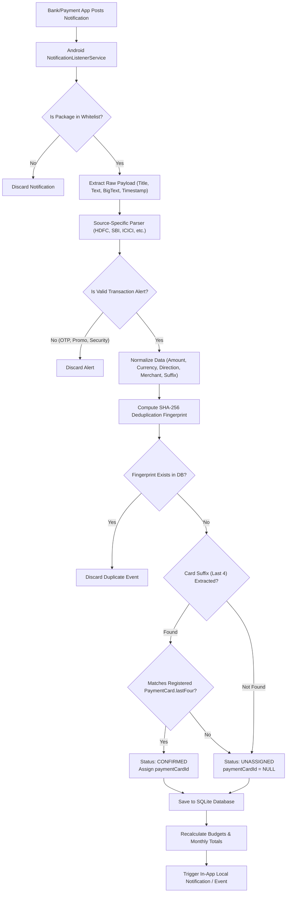
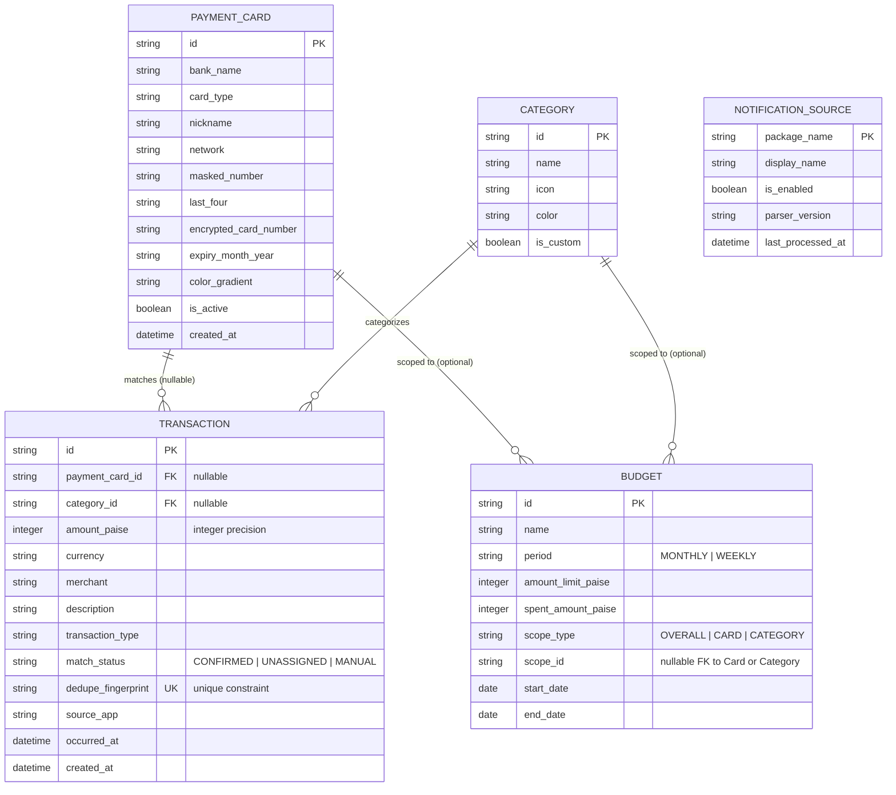
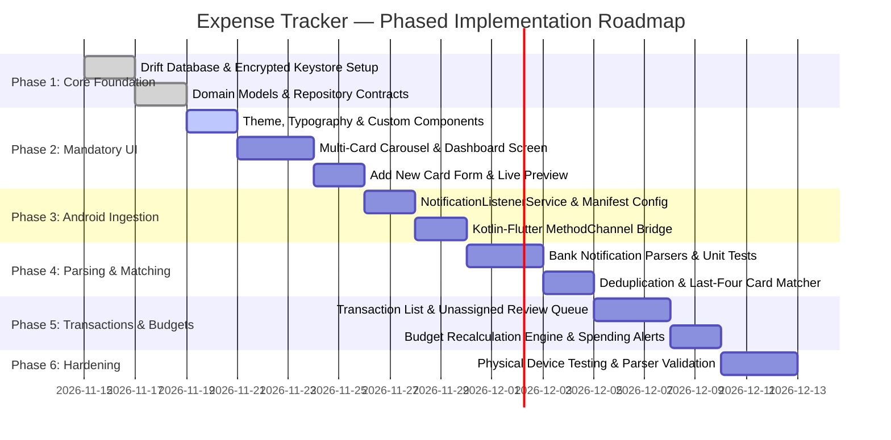

# PROJECT UNDERSTANDING & TECHNICAL ARCHITECTURE SPECIFICATION
## Expense Tracker — Multi-Card Personal Finance & Notification Extraction System

**Document Version:** 1.0.0  
**Project:** Expense Tracker (Local-First Android / Flutter)  
**Author:** Technical Lead & Architecture Team  
**Date:** November 2026  
**Status:** Architecture Proposal & Baseline Specification (Pre-Implementation)

---

## 1. Executive Summary & Product Understanding

### 1.1 The Core Problem
Personal expense management tools suffer from an industry-wide retention cliff: **manual expense logging is tedious, error-prone, and unsustainable**. Most consumers carry multiple financial payment instruments—frequently across multiple banking institutions (e.g., HDFC, SBI, ICICI, Axis)—spanning both debit cards and credit cards. 

Existing solutions fail users in two primary ways:
1. **Generic Manual Trackers:** Require users to open the app and type every transaction manually, leading to abandonment within 14–30 days.
2. **Cloud/SMS Scrapers:** Demand intrusive SMS inbox read permissions (`READ_SMS`), cloud bank credential scraping, or server-side account aggregation. This introduces grave privacy liabilities, exposes sensitive OTPs, violates Google Play SMS policies, and relies on external cloud backends.

### 1.2 Target Audience
* **Multi-Card Holders:** Salaried professionals, business owners, and tech-savvy individuals managing 2 to 6+ payment cards across different banks.
* **Privacy-Conscious Individuals:** Users who refuse to share bank credentials or store personal financial histories on third-party cloud servers.
* **Automation Seekers:** Users who want their expenses organized automatically at the instant of purchase without manual data entry.

### 1.3 Key Product Differentiators
* **Multi-Card First Architecture:** Every card is an independent financial entity with its own visual identity, bank affiliation, network, masked number, credit/debit designation, spending ceiling, and isolated transaction history.
* **Notification-Driven Automation:** Passive, real-time transaction capture powered by Android's native `NotificationListenerService`. Zero SMS permissions and zero bank API logins required.
* **Deterministic Matching vs. Heuristic Guessing:** Strict last-four-digit (`lastFour`) suffix matching. If a notification lacks a card suffix or cannot be resolved with certainty, it is quarantined in an **"Unassigned / Needs Review"** queue. The system never guesses card assignments based on merchant or amount.
* **Transaction Direction & State Awareness:** Distinguishes settled expenses from credits, refunds, reversals, failed authorizations, and self-account transfers.
* **Strict Local-First Privacy:** 100% on-device SQLite/Drift database encrypted via Android Keystore. Zero cloud dependencies, zero external analytics telemetry, zero server backend for the initial release.

---

## 2. Comprehensive Feature Breakdown

```
Expense Tracker
 ├── 1. Card Management & Wallet Module
 │    ├── Multi-card registration (Bank, Type, Network, Nickname, Expiry, Cardholder)
 │    ├── Live card preview with dynamic bank theme and network logo detection
 │    ├── Filterable card carousel (All Cards / Debit / Credit)
 │    └── Card-specific spending summaries and budget utilization
 ├── 2. Automated Notification Ingestion Module
 │    ├── Android NotificationListenerService lifecycle & permission management
 │    ├── Whitelist-based package filtering (Banking, UPI, and Card apps)
 │    ├── Extensible regex parser engine per financial institution
 │    ├── Composite-hash duplicate notification detection
 │    └── Last-four-digit card matching engine
 ├── 3. Transaction Lifecycle & Management Module
 │    ├── Confirmed transaction persistence and card linking
 │    ├── "Unassigned / Needs Review" quarantine queue
 │    ├── Manual transaction creation and edit overrides (Merchant, Category, Card)
 │    ├── Smart category classification (Food, Shopping, Travel, Bills, Fuel, Other)
 │    └── Transaction type filtering (Debit, Credit, Refund, Reversal)
 ├── 4. Budgets & Financial Engine
 │    ├── Overall monthly spending budget
 │    ├── Card-specific budget caps
 │    ├── Category-level budget allocations
 │    ├── Real-time recalculation upon confirmed transaction entry
 │    └── Visual threshold indicators (safe, warning, exceeded)
 ├── 5. Insights & Analytics Module
 │    ├── Month-over-month trend comparison (e.g., "↓ 12% vs last month")
 │    ├── Card-wise distribution percentage
 │    └── Category breakdown visualization
 └── 6. Security & Platform Module
      ├── Zero CVV/PIN/OTP collection guarantee
      ├── Keystore-backed local database encryption
      ├── Offline-only sandbox architecture
      └── Android battery optimization & permission onboarding guide
```

---

## 3. Mandatory UI Reference Specification

The UI specification is derived directly from the mandatory design reference on Page 4 of the product brief (`image1.png`). The visual direction must strictly preserve this dark, polished fintech aesthetic.

```
+--------------------------------------------------------------------------------------------------+
|                                    MANDATORY DESIGN IDENTITY                                     |
+-----------------------------------+--------------------------------------------------------------+
| Base Theme                        | Deep Dark Fintech Palette (`#0B0B12`, `#12121E`, `#1A1A2E`)  |
| Accent & Glow                     | Electric Purple / Violet (`#7C3AED`, `#8B5CF6`, `#A78BFA`)   |
| Typography                        | Modern sans-serif, high contrast white with muted gray subs   |
| Card Depth                        | Subtle 3D elevation, glassmorphism, neon border radiance     |
+-----------------------------------+--------------------------------------------------------------+
```

### 3.1 Screen 1: Multi-Card Dashboard (Home / Cards Screen)
* **Top App Bar:**
  * Left: User profile circular avatar.
  * Center: Brand icon (purple rounded square with chart icon) + "Expense Tracker" title.
  * Right: Notification bell icon with unread badge indicator.
* **Greeting & Subtitle:**
  * Headline: `"Good evening 👋"` in bold white typography.
  * Subtitle: `"Manage your cards and track expenses"` in muted cool-gray.
* **Segmented Filter Pills (Tabs):**
  * Horizontal rounded pill container:
    * `All Cards (3)`: Active pill highlighted with illuminated gradient border and subtle violet glow.
    * `Debit (1)`: Inactive muted pill.
    * `Credit (2)`: Inactive muted pill.
* **Multiple Payment Card Carousel:**
  * Horizontal `PageView` with viewport scaling (~0.82 viewport fraction).
  * **Selected Card (Foreground):** Prominently centered, raised elevation, glowing purple border.
  * **Adjacent Cards (Background Peeking):** Partially visible on left and right edges with distinct card gradients (e.g., cyan-blue, orange-red).
  * **Card Face Elements:**
    * Top Left: Institution logo (e.g., HDFC Bank red square) + Bank Name text.
    * Top Right: Contactless payment wave icon `)))`.
    * Center: Monospace masked number `•••• •••• •••• 4821`.
    * Bottom Left: Card type indicator (e.g., `Debit Card`).
    * Bottom Right: Card network logo (e.g., `VISA`, `Mastercard`, `RuPay`).
  * **Carousel Page Indicators:** Dot pagination directly below carousel (active dot white, inactive dots dimmed gray).
* **Quick Action Grid (4 Squircle Action Tiles):**
  * Tile 1: `[ + ] Add Card` — triggers the Add New Card flow.
  * Tile 2: `[ 🎯 ] Budgets` — opens budget management.
  * Tile 3: `[ 📊 ] Analytics` — opens spending insights.
  * Tile 4: `[ 📅 ] Card Bills` — opens upcoming credit card bill schedules.
* **Cards Overview Container:**
  * Header: `"Cards Overview"` (left), `"This month"` (right, muted).
  * Metric Summary: Large bold total `"₹24,560"` with month-over-month delta badge `"↓ 12% vs last month"`.
  * **Card-Wise Progress List:**
    * Row 1: HDFC Bank icon, `"HDFC Debit ••4821"`, horizontal purple progress bar, `"₹8,420 / 34%"`.
    * Row 2: SBI Bank icon, `"SBI Credit ••7290"`, horizontal blue progress bar, `"₹12,300 / 50%"`.
    * Row 3: ICICI Bank icon, `"ICICI Credit ••1934"`, horizontal orange progress bar, `"₹3,840 / 16%"`.
* **Bottom Navigation Bar (5 Items):**
  1. `Home` (Active, violet icon + label)
  2. `Transactions` (Double exchange arrows)
  3. `Cards` (Credit card outline)
  4. `Budgets` (Target bullseye icon)
  5. `Insights` (Bar chart icon)

### 3.2 Screen 2: Add New Card Flow
* **Top Navigation:** Back arrow (`<`) and centered `"Add New Card"` header.
* **Live Interactive Card Preview:**
  * Renders a real-time reactive card mirror matching the dashboard aesthetic.
  * Dynamically updates bank name, cardholder name, masked card number, expiry date, contactless symbol, and network badge as the user types.
* **Structured Input Form:**
  * `Cardholder Name`: Input field with user silhouette prefix icon (`Enter name on card`).
  * `Card Number`: Input field with card prefix icon, formatting digits in 4-digit blocks (`1234 5678 9012 3456`).
  * Two-Column Row:
    * Left: `Expiry Date` with calendar icon (`MM / YY`).
    * Right: `Card Type` dropdown selector with stacked layers icon (`Select type` -> Debit / Credit).
  * `Card Nickname (Optional)`: Input field with tag prefix icon (`e.g. HDFC Debit`).
* **Security & Compliance Check:**
  * **Explicit Absence of CVV/PIN:** The form intentionally **does not** contain a CVV or PIN field.
* **Action Button:**
  * Full-width illuminated purple gradient button: `"Add Card"`.
* **Security Trust Badge:**
  * Shield icon with checkmark: `"Your card information is stored securely on your device."`

---

## 4. Automatic Transaction Extraction Architecture

### 4.1 End-to-End Extraction Pipeline



### 4.2 Handling Complex Transaction Types
Banking notifications do not represent a homogeneous stream of settled expenses. The extraction engine must classify each event into one of six distinct states:

| Transaction Type | Trigger Indicators | System Behavior |
| :--- | :--- | :--- |
| **Debit (Expense)** | `"debited"`, `"spent"`, `"paid"`, `"charged"` | Counts towards card spending and monthly budget. |
| **Credit (Income/Deposit)** | `"credited"`, `"deposited"`, `"salary received"` | Recorded as inflow; does not inflate expense budget. |
| **Refund** | `"refund of"`, `"reversed"`, `"credited back"` | Reduces card spent total; updates budget balance. |
| **Reversal** | `"transaction reversed"`, `"failed & reversed"` | Reconciles previously debited transaction or offsets. |
| **Failed Transaction** | `"declined"`, `"failed"`, `"insufficient funds"` | Flagged as Informational; excluded from spending totals. |
| **Pending Authorization** | `"pre-auth"`, `"hold"`, `"authorized at"` | Flagged as Pending; confirms upon settlement alert. |

### 4.3 Deterministic Matching & Unassigned Fallback
* **Rule 1:** Matching relies **exclusively** on the last 4 digits of the card number (`lastFour`).
* **Rule 2:** The system **must never** attempt heuristic matching based on merchant name, past habits, or amount magnitude.
* **Rule 3:** Notifications lacking card suffixes (e.g., standard UPI alerts like `"Paid Rs 150 to Swiggy via UPI"`) are routed directly to the `UNASSIGNED / NEEDS REVIEW` table. The user can manually associate them with a card with one tap.

---

## 5. Technical Architecture & Technology Stack

### 5.1 Architecture Layers

```
+---------------------------------------------------------------------------------------+
|                                  PRESENTATION LAYER                                   |
|   Flutter UI • Material 3 Dark • Custom Canvas & Shaders • GoRouter Navigation        |
|   Riverpod StateNotifier / AsyncNotifier • Reactive Live Card Preview                 |
+-------------------------------------------+-------------------------------------------+
                                            | Calls Use Cases / Observes Streams
+-------------------------------------------v-------------------------------------------+
|                                     DOMAIN LAYER                                      |
|   Entities (PaymentCard, Transaction, Budget) • Value Objects (CardSuffix, Money)     |
|   Use Cases: MatchTransaction, DeduplicateNotification, RecalculateBudget             |
|   Repository Interfaces (ICardRepository, ITransactionRepository)                    |
+-------------------------------------------+-------------------------------------------+
                                            | Implements Interfaces
+-------------------------------------------v-------------------------------------------+
|                                      DATA LAYER                                       |
|   Repository Implementations • Drift (SQLite) DAO • Encrypted Storage Source          |
|   Data Transfer Objects (DTO) • Ingestion Mapper • Dedupe Fingerprint Generator       |
+-------------------------------------------+-------------------------------------------+
                                            | Interacts with Native via Channels
+-------------------------------------------v-------------------------------------------+
|                             NATIVE ANDROID INTEGRATION LAYER                          |
|   NotificationListenerService (Kotlin) • MethodChannel / EventChannel Bridge          |
|   Android Keystore Integration • Permission Intent Handling                           |
+---------------------------------------------------------------------------------------+
```

### 5.2 Technology Selection Matrix

| Component | Selected Technology | Justification |
| :--- | :--- | :--- |
| **UI Framework** | **Flutter 3.x (Dart)** | Single codebase, 60/120fps fluid custom rendering, cross-platform architecture ready for future expansion. |
| **Native Integration** | **Kotlin (Android)** | Required for Android `NotificationListenerService` lifecycle and `Android Keystore`. |
| **State Management** | **Flutter Riverpod 2.x** | Compile-safe dependency injection, testable without widget tree, handles asynchronous database streams. |
| **Navigation** | **GoRouter** | Declarative URL-like routing, deep linking, nested shell routes for persistent bottom navigation. |
| **Database** | **Drift (SQLite)** | Strongly-typed SQL queries in Dart, built-in migration support, high performance, reactive stream subscriptions. |
| **Key Storage** | **Android Keystore / EncryptedSharedPreferences** | Hardware-backed cryptographic key generation (TEE/StrongBox); master key never leaves the device. |

---

## 6. Database Design & Entity Relationships

### 6.1 Entity-Relationship Diagram



### 6.2 Critical Database Constraints & Storage Details
1. **Integer Currency Storage (`amount_paise`):** To avoid floating-point rounding errors common with financial math, all monetary values are stored as 64-bit integers in the smallest currency unit (e.g., paise for INR: ₹450.00 = `45000`).
2. **Nullable Card Assignment (`payment_card_id`):** Foreign key constraint with `ON DELETE SET NULL`. Allows transactions to exist in the `UNASSIGNED` state without violating schema integrity.
3. **Unique Deduplication Index:** `CREATE UNIQUE INDEX idx_dedupe ON transactions(dedupe_fingerprint);` prevents race conditions when duplicate notifications arrive in rapid succession.

---

## 7. Security, Compliance & Card Registration Strategy

### 7.1 Crucial Architectural Tradeoff: Full PAN vs. Last Four Digits

> [!IMPORTANT]
> **Architectural Recommendation on Card Number Storage:**
> * **Document Requirement:** The brief notes that the UI may collect the full card number to create a authentic fintech experience, but clarifies that the matching engine relies strictly on the `lastFour`.
> * **Security Risk Analysis:** Storing full Primary Account Numbers (PAN), even when encrypted locally with Android Keystore, subjects the app to severe liability under financial compliance frameworks (PCI-DSS standards strictly discourage PAN retention on consumer mobile storage unless mandatory).
> * **Recommended Architecture:** 
>   1. **Input Stage:** Allow the user to type their full card number into the live interactive form for visual feedback.
>   2. **Processing Stage:** Extract `lastFour`, auto-detect the `network` (Visa, Mastercard, RuPay) via BIN prefixes, and compute `maskedNumber` (`•••• •••• •••• 4821`).
>   3. **Storage Stage:** **Discard the full PAN from memory immediately.** Store only `lastFour`, `maskedNumber`, `bankName`, and `nickname`.
>   4. *Optional Flag:* If business requirements mandate retaining the PAN locally, it **must** be encrypted via AES-256-GCM with keys anchored in the Android Keystore and completely excluded from Android Auto-Backup (`android:allowBackup="false"`).
>   5. **Strict Rule:** CVV, PIN, and OTP are **never requested, collected, stored, or processed under any circumstances**.

---

## 8. Development Environment & Hardware Optimization Plan

### 8.1 Machine Profile & Resource Constraints
* **OS:** Windows 11
* **Processor:** Intel Core i3 (7th Generation, 2 Cores / 4 Threads)
* **RAM:** 8 GB DDR4
* **Disk Storage:** 149 GB free on HDD Partition `E:\`
* **Development Tool:** Antigravity IDE

### 8.2 Low-Spec Hardware Strategy & Guidelines
Running an Android Emulator on an Intel Core i3 with 8 GB RAM and an HDD would cause severe memory paging, 100% disk utilization, and system unresponsiveness. We establish the following operational rules:

1. **Physical Device Deployment Only:**
   * Prohibit the use of Android Virtual Devices (AVD / Android Emulator).
   * Connect a physical Android smartphone running Android 10+ via USB debugging (or wireless ADB).
   * Optional: Use `scrcpy` with `--max-fps 30 -b 4M` for lightweight screen mirroring without memory overhead.
2. **Relocate Gradle & Flutter Caches to Partition `E:\`:**
   * Set `GRADLE_USER_HOME=E:\.gradle` to keep multi-gigabyte build artifacts off the primary C:\ drive and isolated to the workspace disk.
   * Set `PUB_CACHE=E:\.pub-cache`.
3. **Optimize Gradle Build Daemon:**
   * Configure `gradle.properties`:
     ```properties
     org.gradle.jvmargs=-Xmx1536M -XX:MaxMetaspaceSize=512m
     org.gradle.parallel=false
     org.gradle.daemon=true
     ```
   * Restrict Java memory consumption to 1.5 GB to prevent starving the 8 GB system RAM.
4. **Lean Flutter Development:**
   * Utilize Flutter Hot Reload and Hot Restart to avoid full Gradle recompilation cycles.
   * Avoid memory-heavy IDE plugins or unnecessary background daemon watchers.

---

## 9. Phased MVP Development Roadmap



### Detailed Phase Milestones:
* **Phase 1: Foundation & Local Persistence**
  * Establish project structure following Clean Feature-First Architecture.
  * Implement Drift database tables, migrations, and DAOs.
  * Set up secure key handling via Android Keystore.
* **Phase 2: Mandatory UI & Card Experience (Reference Faithful)**
  * Build the custom dark theme with neon purple accents.
  * Implement the Card Carousel with 3D elevation, glowing border, and adjacent card peeking.
  * Implement the Add New Card screen with real-time reactive live preview and field validation.
* **Phase 3: Android Notification Ingestion Engine**
  * Implement `NotificationListenerService` in Kotlin.
  * Implement permission onboarding flow directing users to `ACTION_NOTIFICATION_LISTENER_SETTINGS`.
  * Create `EventChannel` / `MethodChannel` pipeline to stream notification events into Dart.
* **Phase 4: Parsing, Deduplication & Matching Logic**
  * Build modular parsers for major Indian banks (HDFC, SBI, ICICI, Axis).
  * Build SHA-256 composite deduplication engine.
  * Implement deterministic last-four card matcher and Unassigned quarantine routing.
* **Phase 5: Transactions, Unassigned Review & Budget Engine**
  * Create the Transactions view, filtering by card, category, and date.
  * Build the "Needs Review" queue for unassigned transactions.
  * Implement real-time budget recalculation across overall, card-wise, and category-wise scopes.
* **Phase 6: Integration, Verification & Low-Spec Hardening**
  * Test notification capture using real notification broadcasts on a physical Android device.
  * Benchmark RAM usage (< 250 MB running app footprint).

---

## 10. Technical Risks, Android Limitations & Mitigations

| Risk / Limitation | Root Cause | Architectural Mitigation |
| :--- | :--- | :--- |
| **OEM Background Aggression** | Aggressive battery managers (MIUI, OneUI, ColorOS) kill background services. | Implement user guidance for "Don't Optimize Battery" and "Autostart". Use Android Foreground Service with persistent status pill if background drops occur. |
| **Notification Format Volatility** | Banks alter notification wording or layout across app versions. | Implement a versioned, decoupled parser strategy. If a regex fails, capture raw text, flag as `UNASSIGNED`, and allow manual user tagging without crashing. |
| **UPI Missing Suffixes** | UPI transactions often reference VPA (`upi@bank`) rather than a card suffix. | Do not guess card assignment. Route all UPI transactions without card digits to `UNASSIGNED / NEEDS REVIEW`. |
| **Rapid Duplicate Notifications** | Some banking apps issue both an ongoing notification and an updated settled notification. | Multi-tier deduplication: SHA-256 hash on `(source_app + amount + 10-minute-window + merchant + card_suffix)`. |
| **Accidental Multi-Account Transfers** | Moving money between own accounts creates two alerts (Debit from A, Credit to B). | Detect reciprocal amounts within short time intervals and flag as "Internal Transfer" to avoid inflating expense totals. |

---

## 11. Product Acceptance Criteria Checklist

| ID | Requirement | Verification Method |
| :--- | :--- | :--- |
| **AC-01** | Support registering and managing multiple debit and credit cards. | Verify registration, viewing, and editing of at least 3 distinct cards. |
| **AC-02** | Faithfully replicate the mandatory Page 4 reference UI. | Visual audit: dark theme, purple glow, carousel with peeking cards, action grid, overview progress bars, and bottom nav. |
| **AC-03** | Parse supported banking notifications into structured transactions. | Unit & integration tests against sample notification payloads (HDFC, SBI, ICICI). |
| **AC-04** | Match transactions accurately using only the last-four card digits. | Verify transactions are assigned to the registered card sharing the exact suffix. |
| **AC-05** | Ambiguous or suffix-free notifications sent to Unassigned queue. | Verify that alerts lacking card numbers are placed in "Needs Review" without card guessing. |
| **AC-06** | Identical notifications do not create duplicate transactions. | Post identical notification 5 times; confirm exactly 1 database record exists. |
| **AC-07** | Confirmed transactions update card totals, category totals, and budgets. | Confirm ₹450 debit updates card balance, category spend, and decreases remaining budget. |
| **AC-08** | Allow user manual correction of merchant, category, and card assignment. | Edit an unassigned transaction and verify data updates across views. |
| **AC-09** | Zero sensitive card data (CVV, PIN, OTP, unencrypted PAN) logged or exposed. | Inspect application logs, memory dumps, and database file for plaintext card credentials. |
| **AC-10** | Fully operational without internet connectivity or external accounts. | Disconnect device from Wi-Fi/cellular; verify complete functionality. |

---

## 12. Architectural Sign-Off & Next Steps

This specification documents the complete product model, mandatory UI specifications, native extraction engine, local-first database design, security requirements, and low-spec optimization strategy. 

**Next Steps upon User Approval:**
1. Initialize the Flutter project structure with Clean Feature-First modularity.
2. Configure Gradle parameters and directory paths for the Windows 11 / HDD development environment.
3. Begin Phase 1 (Local persistence schema & security integration) and Phase 2 (Mandatory UI implementation).
